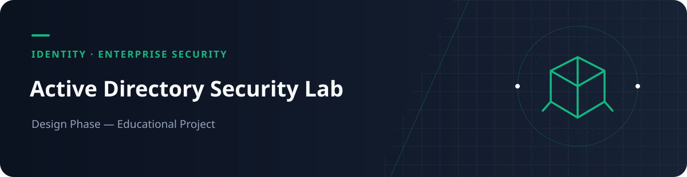
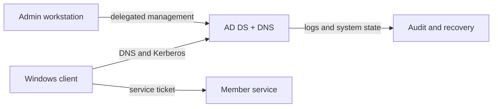

# Active Directory Security Lab

**Design Phase — Educational Project**

Design a small Windows domain and use repeatable configuration evidence to compare identity exposure before and after a hardening program.

## Why this project

Directory objects, delegated permissions and workstation privileges form a trust graph. An isolated lab can expose where approved roles and effective permissions differ.

- Explain how DNS, Kerberos, LDAP and group scopes support domain operations.
- Model and review delegated privileges with reproducible before/after evidence.
- Validate a least-privilege baseline while preserving ordinary sign-in and recovery.

## Proposed system

Use an isolated corp.example.test forest, two domain controllers on an identity segment, one member server and a Windows 11 client on a member segment. Add a dedicated management workstation and restricted backup/log repository. Domain controllers handle protected directory, DNS and time services. Route only needed domain traffic across segments. Separate privileged administration from normal member access, restrict backups to recovery custodians, and perform system-state restore in a disconnected clone.

**Design trade-off.** Use a single forest to focus on authorization and recovery; inter-forest delegation and cloud federation are future work. Pair BloodHound relationship analysis with PowerShell exported ACLs and membership because collection scope can hide edges. Observe NTLM usage before enforcement to avoid breaking legitimate legacy services.

## Engineering stack

Windows Server hosts AD DS and AD-integrated DNS; Windows 11 represents domain clients. Group Policy makes configuration centrally reviewable. PowerShell inventory and Windows event logs provide reproducible baselines. BloodHound is optional for analyzing authorized, read-only relationship datasets with fake identities. Microsoft security baselines provide a reviewed starting point that still needs compatibility testing.

## Trust and technical challenges

- **Excess delegation** across helpdesk to directory. Scoped OU ACLs and periodic group review.
- **Privileged session exposure** across admin to member networks. Dedicated admin workstation and separate admin identity.
- **Legacy auth weakness** across client to services. NTLM audit, staged exceptions, Kerberos verification.
- **Directory outage or unsafe restore** across directory to backups. Separate backup access and isolated restore.

## Lab and acceptance

Estimate 8 logical cores, 24–32 GB RAM and 200 GB SSD for two DCs, one server, a client and an on-demand admin workstation. Use valid Windows evaluation terms, private virtual switching, internal name resolution and clean snapshots.

Capture DNS health, time skew, privileged group membership, delegated ACLs, service account properties, effective GPO, log availability, NTLM use and backup age before change. Re-run using the same scope and config revisions after pilot hardening. Require normal sign-in, service ticket issuance, least-privilege helpdesk, audited group changes and protected account denial. Record signed exceptions for each legacy dependency with expiry. Future recovery trial must restore a disconnected clone, validate DNS and obtain a ticket for a fictional test account before timing the recovery.

## Delivery and professional skills

Directory hierarchy, OU/GPO and delegation matrix, identity lifecycle records, before/after review packet, logging guide and isolated recovery evidence.

Windows identity engineering, access review, policy rollout, infrastructure hardening and backup validation.

Phase 0 design is documented. The [roadmap](ROADMAP.md) tracks four future stages, from a minimal prototype through validation and evidence publication.

## Scope and ethics

Use test identities, approved Windows images and a private forest. Treat backups and relationship exports as sensitive. Review directory changes as leased lab tasks.

## Design references and navigation

- [Architecture](docs/architecture.md) · [Technical design](docs/technical-design.md) · [Threat model](docs/threat-model.md)
- [Learning objectives](docs/learning-objectives.md) · [Testing strategy](docs/testing-strategy.md) · [Lab requirements](docs/lab-requirements.md)
- [Official references](docs/references.md) · [Evidence template](templates/baseline-review.md) · [Security](SECURITY.md)
- [Back to the portfolio](https://github.com/Hrr-Yassin)
