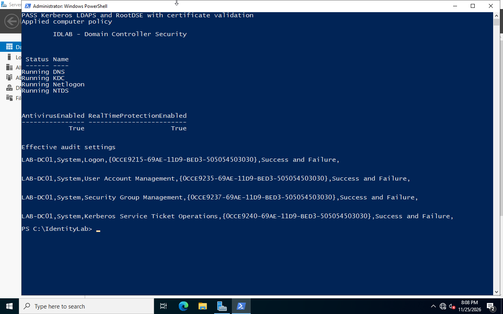
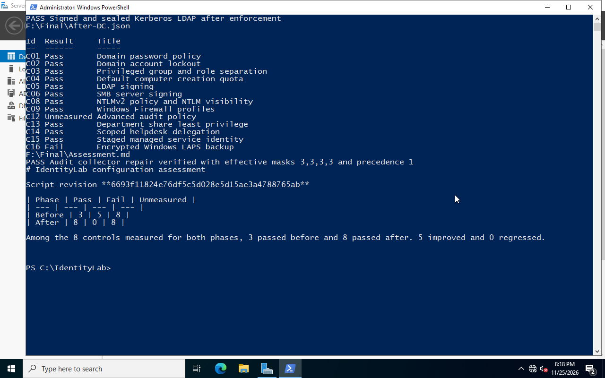
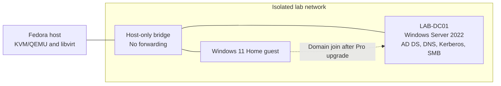
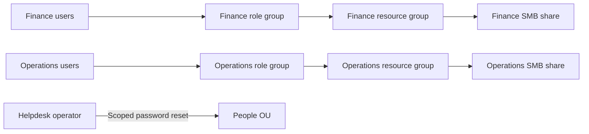
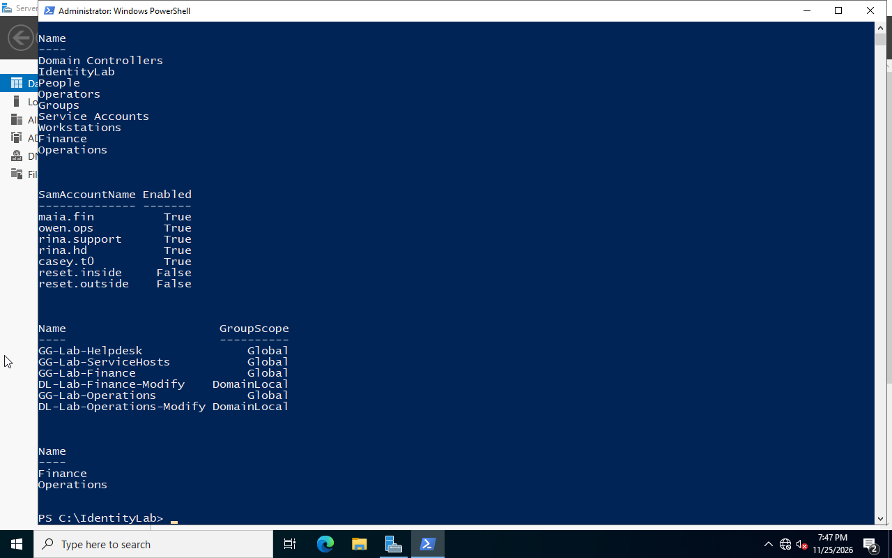

# Enterprise Active Directory Security Lab

**An isolated Windows Server lab for identity administration, least-privilege access, and Group Policy hardening.** The lab runs on Fedora with KVM/libvirt and uses fictional Finance and Operations departments to test access boundaries.

[Architecture](#architecture) · [Hardening results](#hardening-results) · [Reproduce and verify](#reproduce-and-verify) · [Evidence index](evidence/README.md)

*Live domain controller capture showing validated LDAPS, the applied security policy, and effective audit settings. Click the image to view it at full resolution.*

## Hardening results

| Phase | Passing controls among the 8 measured in both phases |
| --- | --- |
| Before hardening | `███░░░░░` **3 / 8** |
| After hardening | `████████` **8 / 8** |

Five controls improved and zero regressed. The assessment defines 16 controls, of which eight remained unmeasured in the paired comparison. The Windows 11 Home guest is on the isolated network. Domain join and endpoint validation are pending a Windows 11 Pro upgrade. [Paired assessment](evidence/assessment.md)

*Live assessment output showing the before-and-after totals. The paired report records each control and its measurement status.*

## What the lab demonstrates

| Area | Verified behavior |
| --- | --- |
| **Domain services** | Native checks passed for AD DS, DNS, Kerberos, SYSVOL, and NETLOGON on `LAB-DC01`. A Kerberos LDAPS bind passed with certificate validation. |
| **Department access** | Finance and Operations users passed signed SMB access checks. Each department's access is assigned through role groups and share and NTFS permissions. |
| **Helpdesk delegation** | The helpdesk operator succeeded on an in-scope password reset and was denied outside its assigned scope. |
| **Group Policy and auditing** | The domain controller applied its security GPO. The live console recorded real-time Defender protection and effective audit settings. |

## Architecture

[Network and identity architecture](docs/architecture.md) · [Authentication flow](docs/technical-design.md) · [Threat model](docs/threat-model.md)

### Identity and access

*Live directory and share inventory showing the organizational units, fictional users, role groups, and department shares.*

## Reproduce and verify

1. Check the [resource and licensing requirements](docs/lab-requirements.md) and follow the [deployment runbook](docs/deployment.md).
2. Provision AD DS, DNS, the fictional identity tree and two scoped SMB shares. Capture the DC baseline and verify the approved client’s secure channel when its edition supports the join.
3. Review the [control matrix](docs/controls.md) and apply hardening in stages. Verify effective settings, compatibility and authorized access.
4. Generate the [before-and-after assessment](docs/assessment.md) from paired native measurements and retain relevant [screenshots and evidence](evidence/README.md).

| Entry point | Purpose |
| --- | --- |
| `host/Inspect-LabHost.sh` | Read host capacity, routes and libvirt inventory |
| `powershell/Install-LabDomain.ps1`, `Join-LabWorkstation.ps1` | Create the lab forest and join the approved workstation |
| `powershell/Initialize-LabDirectory.ps1`, `Initialize-LabShares.ps1` | Create fictional identities, OUs, groups and resource ACLs |
| `powershell/Set-LabHardening.ps1`, `Set-LabAuditPolicy.ps1` | Stage and apply security settings |
| `powershell/Get-LabHealth.ps1`, `Test-LabIdentity.ps1`, `Test-LabDelegation.ps1` | Exercise DNS, the secure channel, authentication and permission boundaries |
| `powershell/Get-LabAssessment.ps1`, `New-LabAssessmentReport.ps1` | Capture before/after state and generate a sanitized evidence report |

Mutation scripts require explicit application and an exact lab scope. Read-only captures and public summaries omit credentials. Windows setup and activation use legitimate media and supported procedures.

## Review the work

- [Goals](GOALS.md), [execution plan](PLANS.md), and [status](PROGRESS.md)
- [Architecture decisions](docs/decisions/0001-single-dc-pilot.md), [network isolation](docs/decisions/0002-host-only-network.md), and [assessment method](docs/decisions/0003-native-measurement.md)
- [Threat model](docs/threat-model.md), [identity security practices](docs/identity-security.md), and [interview guide and CV bullets in English and French](docs/interview.md)
- [Five-minute demonstration](docs/interview.md#five-minute-demonstration)
