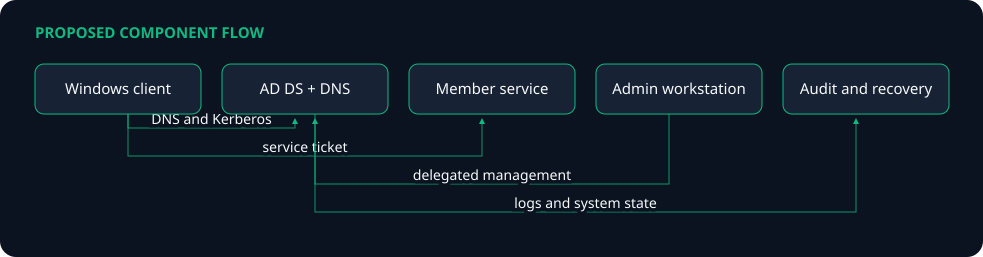
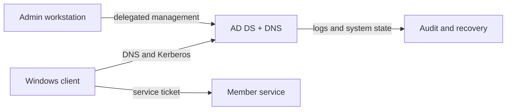

# Architecture

**Proposed topology**

Use an isolated corp.example.test forest, two domain controllers on an identity segment, one member server and a Windows 11 client on a member segment. Add a dedicated management workstation and restricted backup/log repository. Domain controllers handle protected directory, DNS and time services. Route only needed domain traffic across segments. Separate privileged administration from normal member access, restrict backups to recovery custodians, and perform system-state restore in a disconnected clone.

| Source | Destination | Interface or record |
| --- | --- | --- |
| Windows client | AD DS + DNS | DNS and Kerberos |
| Windows client | Member service | service ticket |
| Admin workstation | AD DS + DNS | delegated management |
| AD DS + DNS | Audit and recovery | logs and system state |

## Decision and limitation

Use a single forest to focus on authorization and recovery; inter-forest delegation and cloud federation are future work. Pair BloodHound relationship analysis with PowerShell exported ACLs and membership because collection scope can hide edges. Observe NTLM usage before enforcement to avoid breaking legitimate legacy services.

See [security boundaries](threat-model.md) and [deployment assumptions](lab-requirements.md).
