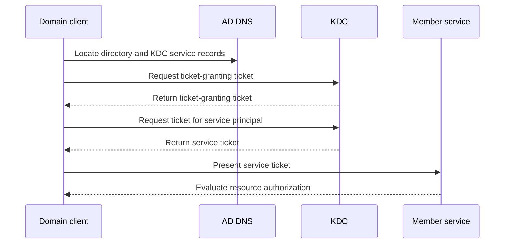

# Technical design

**Phase 0 specification**

Define OUs for Workstations, Member Servers, Admin Workstations and separate user populations; use the built-in Domain Controllers OU for DC policy. Assign global groups to job functions and domain-local groups to resource permissions. Delegate narrowly scoped join, password reset and group ownership tasks. Use separate administrative accounts and a documented emergency account. On join, create and approve group membership; on role change, reconcile access and expiry; on exit, disable the account and review sessions and group inheritance. Keep service identities separate and use gMSAs where supported. Apply GPOs to pilot OUs with a rollback record; collect resultant policy, audit changes to privileged groups and track allowed NTLM dependencies before reducing legacy access. Verify DNS and time health before attributing Kerberos failures to a policy.

## Authentication sequence

Record LDAP signing/channel binding and secure transport as explicit decisions. Authentication identifies the principal; resource ACLs still govern access.

## Technology rationale

Windows Server hosts AD DS and AD-integrated DNS; Windows 11 represents domain clients. Group Policy makes configuration centrally reviewable. PowerShell inventory and Windows event logs provide reproducible baselines. BloodHound is optional for analyzing authorized, read-only relationship datasets with fake identities. Microsoft security baselines provide a reviewed starting point that still needs compatibility testing.

See [acceptance criteria](testing-strategy.md) and [authoritative references](references.md).

## Identity hierarchy and policy owners

| Population | Proposed placement and controls | Owner |
| --- | --- | --- |
| Ordinary employees | Users OU, role-specific global groups, access through domain-local resource groups | Identity lifecycle operator |
| Helpdesk | Separate support accounts, reset permissions scoped to pilot employee OU, change audit | Helpdesk lead |
| Directory administrators | Dedicated accounts and isolated admin workstations, no ordinary resource access | Directory owner |
| Server and workstation operators | Distinct role groups and device OUs, GPO changes reviewed independently | Infrastructure owner |
| Recovery custodians | Backup access, controlled emergency identity and disconnected recovery rehearsals | Recovery owner |

Baseline checks include account review cadence, admin logon restrictions, LDAP policies, GPO inheritance, advanced audit policy and repository restore permissions. Use directory changes audited under applicable policy and SACLs. Capture effective policy and group membership before each pilot change so rollback can be validated.
